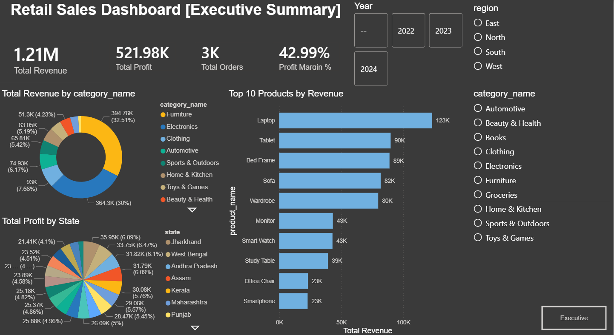
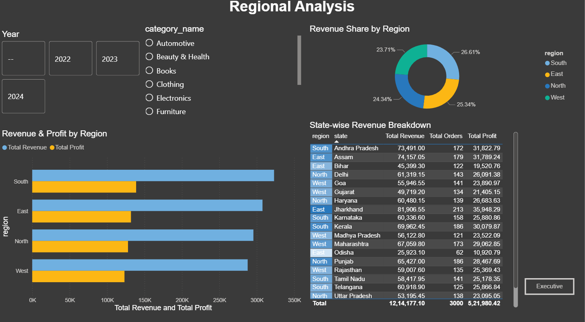
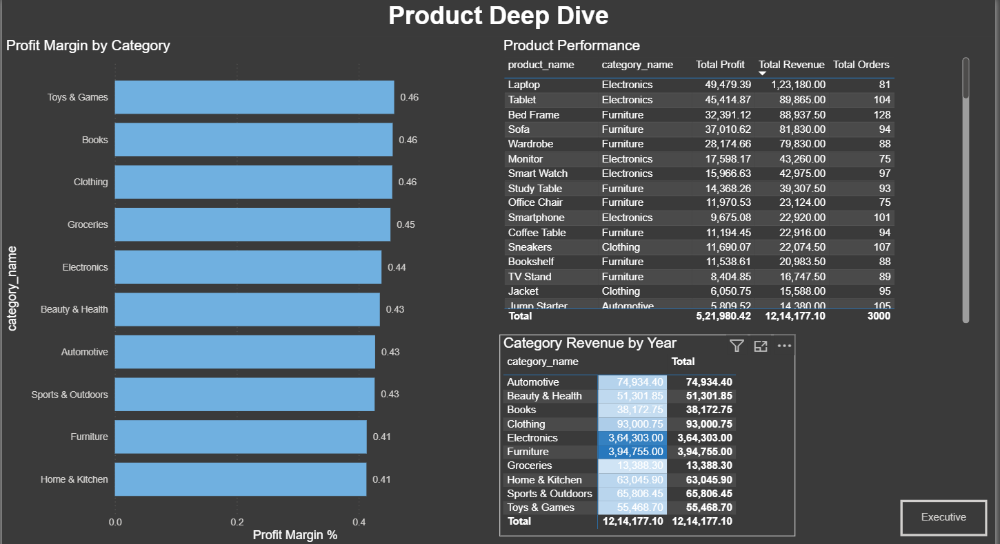
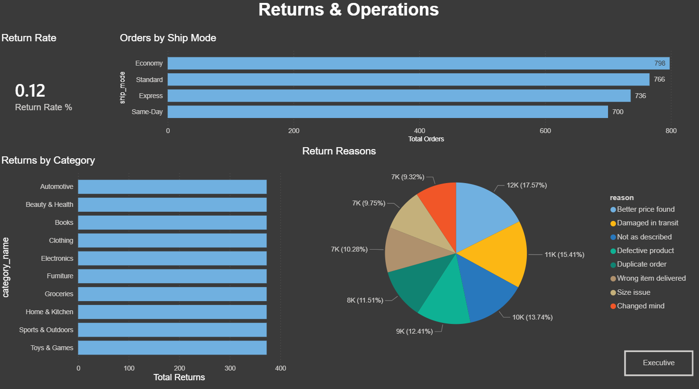
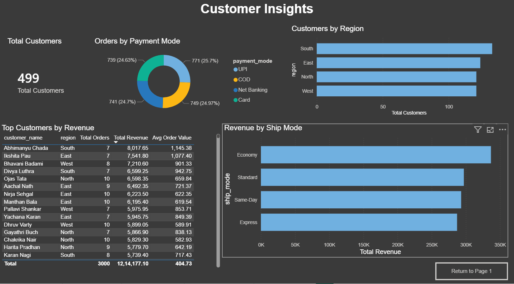

# Retail Sales & Business Intelligence Dashboard

> **Transforming Retail Data into Actionable Business Insights**
>
> An end-to-end retail analytics project built using **MySQL, Python, and Power BI** to analyze sales, profitability, regional performance, product categories, returns, and customer behavior. The project processes **3,000 orders across 500 customers and 10 product categories**, delivering a 5-page interactive dashboard. Key findings include **20.10% revenue growth in 2024** and a **62.51% revenue contribution from Furniture and Electronics**.


**Quick Links:** [Dashboard Preview](#6-dashboard-preview--visual-highlights) · [Dataset Overview](#3-dataset-overview--data-dictionary) · [Key Findings](#7-key-insights--findings)

---

## 2. Business Problem / Problem Statement

Retail businesses need to understand what drives revenue, profitability, customer purchasing behavior, and product returns to make effective decisions.

Without consolidated reporting, identifying high-performing categories, profitable regions, return patterns, and customer segments becomes difficult.

**Business goal:** Build a centralized analytics solution that helps stakeholders monitor performance, identify growth opportunities, and make data-driven decisions about products, customers, and operations.

## 3. Dataset Overview & Data Dictionary

The project uses a **synthetically generated retail dataset** created with Python, Pandas, and Faker.

| Dataset / Table | Records | Key Fields | Business Definition |
|---|---:|---|---|
| `customers` | 500 | customer_id, region | Customer profiles and locations |
| `products` | 100 | product_id, category_id | Product catalog |
| `categories` | 10 | category_id, category_name | Product classification |
| `orders` | 3,000 | order_id, order_date, customer_id | Customer transactions (2022–2024) |
| `order_items` | ~8,500 | product_id, quantity, revenue, profit | Individual items within orders |
| `returns` | ~180 | order_id, return_reason | Returned items and reasons |

**Database:** MySQL relational database with six normalized tables and a reporting view.

**Primary Power BI data source:** `vw_sales_fact`, a denormalized view joining the core sales tables.

**Note:** The source project details do not specify the exact final row and column counts of the generated reporting view.

## 4. Project Objectives & Key Business Questions

### Analytical Objectives

- Analyze revenue, profit, and order trends across years, regions, and categories.
- Identify top-performing and low-performing products and categories.
- Evaluate returns, payment preferences, and operational performance.
- Understand customer segments and purchasing behavior through interactive dashboards.

### Key Business Questions

1. How much revenue and profit does the business generate?
2. Which product categories contribute the most to total revenue?
3. Which regions and states generate the highest sales?
4. How has revenue changed year over year?
5. Which products and customer segments contribute most to sales?
6. What are the return rate and most common return reasons?
7. How do payment methods, discounts, and shipping preferences vary?

## 5. Methodology & Analytical Workflow

| Stage | Activities | Tools |
|---|---|---|
| Data Generation | Generated customers, products, orders, order items, and returns | Python, Faker, Pandas |
| Database Design | Designed six relational tables with primary and foreign keys | MySQL |
| SQL Analysis | Developed 17 business queries using aggregations, CTEs, subqueries, and window functions | MySQL |
| Data Integration | Created `vw_sales_fact` to combine data for reporting | MySQL Views |
| KPI Development | Defined revenue, profit, margin, AOV, YoY growth, and return rate | DAX |
| Visualization | Built five interactive dashboard pages with slicers and conditional formatting | Power BI |

### Key DAX Measures

- Total Revenue
- Total Profit
- Total Orders
- Profit Margin %
- Average Order Value
- Year-over-Year Growth %
- Return Rate %
- Total Customers

### SQL Analysis Coverage

**17 business queries** covering KPI totals, monthly trends, category contribution, top products, regional performance, YoY growth, customer ranking, payment methods, returns, profit margins, discount tiers, and sales patterns.

## 6. Dashboard Preview & Visual Highlights

The Power BI dashboard contains five pages designed to provide a clear view of retail performance.

### Page 1 — Executive Summary


*High-level KPIs, monthly revenue trends, category contribution, and top products.*

### Page 2 — Regional Analysis


*Revenue and profit comparison across regions, with state-level sales breakdown.*

### Page 3 — Product Deep Dive


*Category performance, yearly revenue comparisons, and product profitability.*

### Page 4 — Returns & Operations


*Return rate, return reasons, monthly return trends, and shipping preferences.*

### Page 5 — Customer Insights


*Customer rankings, regional distribution, payment preferences, and shipping insights.*

## 7. Key Insights & Findings

- **Total Revenue:** Generated **₹12,14,177** from **3,000 orders**.
- **Revenue Growth:** Revenue was nearly flat in 2023 at **+0.23%**, followed by **+20.10% growth in 2024**.
- **Category Contribution:** Furniture contributed **32.51%** and Electronics **30.00%**, together accounting for **62.51% of total revenue**.
- **Regional Performance:** The **South region** led in both revenue and order volume.
- **Returns:** The overall return rate was approximately **12%**, highlighting an opportunity to investigate product and operational issues.
- **Customer & Payment Behavior:** UPI was the most popular payment method, while Q4 (October–December) recorded the highest monthly revenue across the years.

## 8. Actionable Business Recommendations

| Finding | Recommendation | Business Opportunity |
|---|---|---|
| Furniture and Electronics contribute 62.51% of revenue | Prioritize inventory planning and availability for these categories | Protect revenue from the strongest categories |
| Revenue grew 20.10% in 2024 | Analyze the products and regions driving growth before allocating expansion budgets | Focus investment on proven growth areas |
| South leads regional performance | Study successful sales patterns and identify opportunities to improve other regions | Improve regional sales performance |
| Return rate is approximately 12% | Investigate return reasons by product and category; prioritize recurring issues | Reduce avoidable returns and associated costs |
| UPI is the most popular payment method | Monitor UPI checkout performance and payment failures | Improve checkout experience |

*Recommendations are proposed business actions. Financial savings and revenue improvements have not been quantified or validated through experiments.*

## 9. Repository Structure & How to Run

```text
retail-sales-dashboard/
│
├── sql/
│   ├── 01_schema.sql
│   └── 02_analysis_queries.sql
│
├── python/
│   └── retail_data_generator.py
│
├── screenshots/
│   ├── Page1_Executive_Summary.png
│   ├── Page2_Regional_Analysis.png
│   ├── Page3_Product_Deep_Dive.png
│   ├── Page4_Returns_Operations.png
│   └── Page5_Customer_Insights.png
│
├── powerbi_guide/
│   └── powerbi_setup.md
│
├── Retail_Sales_Dashboard.pbix
└── README.md
